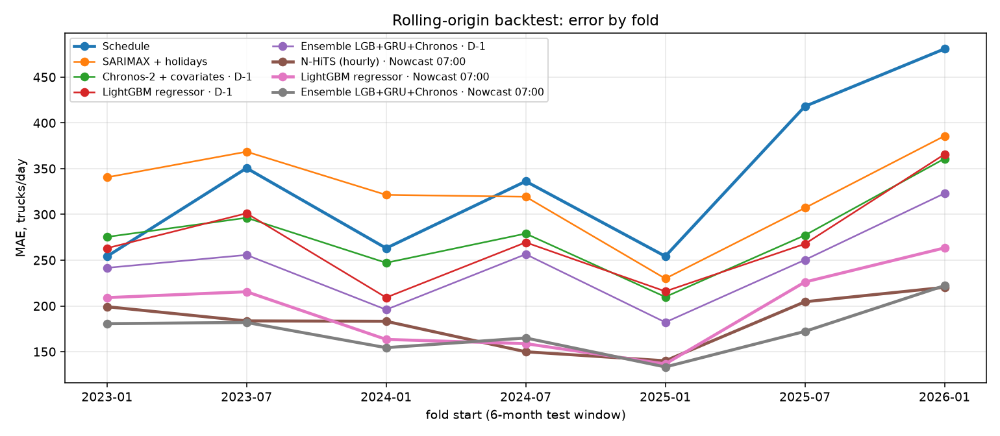
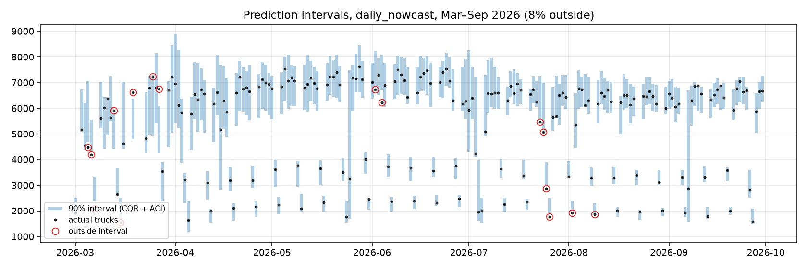

# Truck Demand vs. Schedule — fleet forecasting on real WIM data

[](https://github.com/Vladimir-Aristov/logistics/actions/workflows/ci.yml)
[](https://github.com/Vladimir-Aristov/logistics/actions/workflows/monthly.yml)

**Live monitoring dashboard:** https://vladimir-aristov.github.io/logistics/

Will today need **more or fewer trucks than the schedule says?**
This project answers that on ~7 years of real per-vehicle sensor data from the
Brooklyn-Queens Expressway (NYC Weigh-in-Motion, 105M vehicle records, Oct 2019 – Sep 2026),
and turns the forecast into a dispatch plan with an asymmetric cost.

**Headline (rolling backtest, 1098 days):**
* forecasting at **07:00** with the morning's traffic cuts the daily error by **49%** and dispatch
  cost by **45%** vs. the schedule, and beats a simple "scale by the morning" rule by a third;
* a forecast made **the evening before** cuts the error by 28%;
* a **zero-shot foundation model** (Chronos-2, no training on this data) is on par with tuned
  LightGBM the evening before, and its 90% intervals are well calibrated;
* **adaptive conformal intervals** hit 90% coverage (≥ 87% in every fold) where raw quantiles give 84%;
* classical ETS / MSTL / SARIMAX models do not beat the schedule.

## Problem framing

The Queens-bound truck flow on the BQE is treated as the outbound demand of a carrier.

* **Schedule (baseline).** Dispatch plans, for each day, the median number of trucks
  on the same weekday over the last 4 valid weeks — a common rule of thumb in fleet planning.
* **Target.** `ratio = actual / schedule` for day *D*. Two forecast moments:
  * **D-1** — at the end of the previous day;
  * **Nowcast 07:00** — on the day itself, after seeing the first 7 hours of traffic
    (the morning trucks have already left, the rest of the fleet can still be adjusted).
  * `below`  — ratio < 0.90 → fewer trucks needed
  * `normal` — within ±10%
  * `above`  — ratio > 1.10 → extra trucks needed
* **Decision.** A missing truck is hired on the spot market at 2.5× cost, an idle
  scheduled truck costs 1×. The cost-optimal plan is the 71% quantile of demand,
  learned directly with a LightGBM quantile objective.

## Data

| Source | What | Use |
|---|---|---|
| [NYC Open Data — Weigh in Motion (Historical)](https://data.cityofnewyork.us/d/n5c8-x7x2) + [(from 2025)](https://data.cityofnewyork.us/d/4fwc-j3vn) | one row per vehicle: time, lane, FHWA class, gross weight, axles | demand series |
| [MTA Bridges & Tunnels hourly crossings](https://data.ny.gov/d/ebfx-2m7v) | trucks per hour at 10 NYC bridges/tunnels (incl. Hugh L. Carey Tunnel and Verrazzano, next to the BQE) | regional demand signal |
| [Open-Meteo archive](https://open-meteo.com/) + [previous runs](https://open-meteo.com/en/docs/previous-runs-api) | NYC weather: observed, and the forecast issued the day before | exogenous |
| [FRED GASDESW](https://fred.stlouisfed.org/series/GASDESW) | US weekly diesel price | tested, dropped (see ablations) |

Aggregation runs **server-side** (SoQL `GROUP BY` hour × lane × class), so the raw
100M rows never leave the portal. Trucks = FHWA classes 5–13 (buses and cars excluded).

**Sensor-outage filter.** A WIM site goes dark sometimes (lane closures, maintenance).
A day is kept only if all 24 hours and all usual lanes reported, and car traffic —
used as a control group — stays within a normal band. Without this filter a model
"learns" to predict sensor failures instead of demand.

## Method

* **Features known at forecast time:** calendar & NY holidays (distance to/from holiday, bridge
  days, late December), logistics calendar (Black Friday, Cyber Monday, Thanksgiving week, peak
  season, quarter end, Jewish holidays), lags/rolling stats of the ratio, trend, weather,
  MTA truck traffic vs. its weekday norm (yesterday, last week, rolling).
* **Nowcast adds** the morning of day *D* (00:00–07:00): WIM trucks vs. the usual morning for
  that weekday, and the same for MTA bridges & tunnels.
* Holidays are excluded from the schedule window (any planner knows them), so the
  baseline is not a strawman.
* Models
  * baselines: schedule, seasonal naive, classical TS (ETS, MSTL, SARIMAX with holiday
    regressors, via `statsforecast`);
  * gradient boosting: LightGBM regressor / classifier / quantile planner;
  * deep learning: GRU (PyTorch, 28-day sequence + day-D features, multitask, 5-seed average) and
    **N-HiTS on the hourly series** (`neuralforecast`, ~60k points instead of ~1.4k days;
    the day's forecast is the sum of its hours, and in the nowcast the known morning plus hours 07–23);
  * foundation models, **zero-shot**: Chronos-Bolt and Chronos-2 (univariate), Chronos-2 with
    past and known-future covariates (calendar, weather, lane configuration, MTA, morning traffic);
  * ensembles: equal-weight geometric mean of ratio forecasts (LGB+GRU, LGB+GRU+Chronos-2), no tuning.
* **Prediction intervals** (90%): split conformal, conformalized quantile regression (CQR),
  and CQR with adaptive conformal inference (ACI), which updates its level daily from realised coverage.

## Evaluation

**Rolling-origin backtest.** 7 folds of 6 months (Jan 2023 → Sep 2026, 1098 valid days),
expanding training window, early stopping on the last 120 days before each fold.
Metrics are reported as mean ± std across folds; significance vs. the schedule uses a
Diebold–Mariano test (Newey–West, weekly lag) and a 95% CI from a block bootstrap over weeks.

| Model | Macro-F1 | Recall *below* | Recall *above* | MAE, trucks/day | Dispatch cost vs schedule [95% CI] |
|---|---|---|---|---|---|
| Schedule (baseline) | 0.30 ± 0.02 | 0.00 | 0.00 | 337 ± 88 | — |
| Naive: last week's deviation | 0.45 ± 0.06 | 0.21 | 0.26 | 433 ± 108 | +48% [+30, +70] |
| ETS (weekly) | 0.47 ± 0.08 | 0.36 | 0.13 | 361 ± 79 | +27% [+17, +39] |
| MSTL (weekly + yearly) | 0.43 ± 0.07 | 0.42 | 0.15 | 462 ± 68 | +53% [+39, +69] |
| SARIMAX + holidays | 0.50 ± 0.10 | 0.47 | 0.13 | 325 ± 50 | +14% [+2, +28] |
| *Forecast at D-1* | | | | | |
| Chronos-Bolt (zero-shot) | 0.47 ± 0.08 | 0.42 | 0.27 | 359 ± 68 | −1% [−9, +8] |
| Chronos-2 (zero-shot, univariate) | 0.53 ± 0.08 | 0.39 | 0.34 | 298 ± 54 | −20% [−26, −13] ¹ |
| Chronos-2 + covariates (zero-shot) | 0.54 ± 0.11 | 0.43 | 0.33 | 278 ± 46 | **−24% [−29, −18]** ¹ |
| N-HiTS (hourly) | **0.55** ± 0.09 | 0.55 | 0.32 | 299 ± 65 | +1% [−13, +16] |
| LightGBM regressor / classifier | 0.52 / 0.54 | 0.41 / 0.47 | 0.10 / 0.21 | 270 ± 53 | −8% [−14, −1] |
| LightGBM quantile q=0.71 (plan) | — | — | — | 270 ± 53 | −23% [−28, −19] |
| GRU (PyTorch, 5 seeds) | 0.53 ± 0.10 | **0.63** | **0.37** | 274 ± 53 | −10% [−16, −3] |
| Ensemble LGB+GRU | 0.50 ± 0.05 | 0.47 | 0.05 | 261 ± 50 | −13% [−19, −6] |
| Ensemble LGB+GRU+Chronos-2 | 0.54 ± 0.10 | 0.47 | 0.11 | **244 ± 46** | −19% [−24, −13] |
| *Nowcast at 07:00* | | | | | |
| Rule: schedule × morning ratio | 0.65 ± 0.06 | 0.70 | **0.75** | 261 ± 66 | −12% [−21, −2] |
| Chronos-2 + covariates (zero-shot) | 0.59 ± 0.10 | 0.57 | 0.33 | 228 ± 32 | −38% [−43, −32] ¹ |
| N-HiTS (hourly) | 0.67 ± 0.11 | 0.66 | 0.51 | 183 ± 29 | −41% [−47, −34] |
| LightGBM regressor / classifier | **0.71** / 0.70 | 0.70 / 0.72 | 0.43 / 0.48 | 196 ± 45 | −30% [−36, −24] |
| LightGBM quantile q=0.71 (plan) | — | — | — | 196 ± 45 | **−45% [−49, −41]** |
| GRU (PyTorch, 5 seeds) | 0.61 ± 0.08 | **0.77** | 0.57 | 192 ± 36 | −29% [−34, −22] |
| Ensemble LGB+GRU | 0.67 ± 0.08 | 0.68 | 0.29 | 179 ± 36 | −34% [−39, −28] |
| Ensemble LGB+GRU+Chronos-2 | 0.70 ± 0.09 | 0.69 | 0.32 | **173 ± 28** | −37% [−42, −32] |

¹ Chronos plans on its own 0.71 quantile (it is probabilistic out of the box); other models plan
on their point forecast unless marked "quantile".

All learned models beat the schedule with Diebold–Mariano p < 1e-5 (nowcast: p < 1e-12).
The nowcast models also beat the simple morning rule — the ensemble by −32% MAE (p ≈ 3e-18),
the quantile planner by −37% cost (p ≈ 2e-17) — so the gain is not just "we saw the morning".



Takeaways
* **When you forecast matters as much as which model you use.** At 07:00 about 31% of the day's
  trucks have already passed; the model turns that into a forecast for the rest of the day and cuts
  the error of the evening-before forecast by a third (MAE 261 → 179). A naive "scale the schedule by
  the morning" rule gets nowhere near that (261), and removing the morning features costs +26% MAE.
* **Optimise the decision, not the error.** With the same point accuracy, the quantile planner
  saves 23–45% of dispatch cost vs. 8–30% for planning on the median forecast.
* **Classical TS models lose to the schedule.** They see lane re-configurations (3 → 2 → 1 → 2 lanes)
  as level shifts and need weeks to adapt; the scale-free `actual / schedule` target absorbs them.
* **A foundation model is a serious baseline now.** Chronos-2 with covariates, never trained on
  this data, matches tuned LightGBM the evening before (MAE 278 vs 270) and gives the cheapest D-1
  plan from its own quantiles. It is weaker at using the morning (228 vs 196) — and adding it to the
  ensemble still gives the best model in both setups (244 / 173). Chronos-Bolt does not cope
  (≈ schedule), likely due to the sensor gaps and level shifts.
* **Deep learning needs the right granularity.** On ~1.4k daily points the GRU is on par with LightGBM;
  N-HiTS on ~60k hourly points is the best single model for the nowcast (183) — it naturally
  "continues" a day that has started — but weak a full day ahead (299).
* The GRU is the best detector of unusual days (recall 0.77 *below*), LightGBM the best
  cost model, the 3-model ensemble the most accurate. "Last week's deviation" is worse than doing nothing.

### Prediction intervals (target 90%)

| Method | Coverage D-1 | Coverage nowcast | Worst fold | Mean width, trucks (D-1 / nowcast) |
|---|---|---|---|---|
| LightGBM 5–95% quantiles, raw | 84.0% | 84.6% | 79% | 1103 / 814 |
| Split conformal (abs. residual) | 87.3% | 87.6% | 78% | 1134 / 833 |
| CQR | 86.2% | 88.5% | 80% | 1147 / 882 |
| **CQR + adaptive conformal (ACI)** | **90.0%** | **90.3%** | **87%** | 1386 / 968 |
| Chronos-2 + covariates, native 5–95% | 93.4% | 94.6% | 89% | 1338 / 1184 |

Static calibration under-covers because the data drift between the calibration window and
the fold; ACI fixes that by adapting daily (γ = 0.01). The nowcast interval is 30% narrower.
Chronos-2's native intervals are conservative (over-cover) yet narrower than ACI the evening before.



**What did not help (reported on purpose)**

| Experiment | Result |
|---|---|
| MTA traffic & logistics calendar at D-1 | no gain (−20.2% vs −20.0% MAE vs schedule); yesterday's MTA duplicates our own yesterday's ratio. MTA *does* help the nowcast (+3% MAE without it, p < 0.001) |
| Weather: D-1 forecast instead of archive (790 days with forecasts) | MAE 280 → 285 (+1.6%), plan cost unchanged — archive weather was only slightly optimistic |
| Diesel price | ranked high in importance but **−1.7% MAE when removed**: a proxy for time → dropped |
| Truck mix (tractor-trailer share, tons per truck, night share) | **−11% MAE in the nowcast when removed**, stable across 3 seeds (226 → 200). Cause: sensor drift, not demand — tons/truck 22.6 (2019) → 12.9 (2026), tractor-trailer share 45% → 27% as lanes were re-configured → dropped |

*Caveat:* the two drops above were decided on the same backtest. Each has an independent
domain reason (time proxy, measurement drift), but the final numbers carry a small selection bias.

**Ablations (D-1 + nowcast)** — `reports/ablation_daily*_summary.csv`, `reports/ablation_phase1_summary.csv`.
The strongest groups: morning traffic (nowcast, +26% MAE without), ratio lags (+8%),
calendar (+2–9%), weather (+2–4%).

**Leakage tests.** `tests/test_leakage.py` rebuilds the whole feature table with everything
unknown at forecast time wiped (WIM and MTA from day *D* on; for the nowcast, all of day *D*
except its morning) and requires identical features. On its first run it caught a real leak:
the schedule used day *D*'s own lane configuration. Fixed by using the configuration as of *D-1*.

## Production: frozen model + shadow monitoring

The WIM portal publishes **monthly**, so there is no live feed to forecast tomorrow from.
The production setup is therefore a **shadow deployment**: the model is frozen at a cutoff and,
whenever new data is published, a scheduled GitHub Action scores it on the days it has never seen,
checks drift and health, and updates a dashboard on GitHub Pages.

```
GitHub Actions (cron 3rd/10th/20th)          models/  lgbm_{d1,nowcast}_<cutoff>.joblib + model card .json
  wim update   refetch current year only  ─►  monitoring/  shadow_*.csv  drift_*.csv  status.json
  wim build    rebuild feature tables         docs/index.html  (GitHub Pages dashboard)
  wim shadow   score frozen model, ACI intervals, drift (PSI), health
  wim dashboard
```

**Shadow results so far** — model frozen on 2026-06-30, scored on Jul–Sep 2026 (92 unseen days):

| Mode | MAE, trucks/day | Schedule MAE | Dispatch cost vs schedule | 90% interval coverage |
|---|---|---|---|---|
| D-1 (evening before) | 263 | 369 | −15% | 96% |
| Nowcast 07:00 | 201 | 369 | −39% | 96% |

**Health policy.** Performance decides: retraining is recommended if, over the last 28 observed days,
the model stops beating the schedule or interval coverage falls below 80%. Feature drift (PSI > 0.25
on an important feature, measured against **the same season last year** — a whole-year reference flags
plain seasonality) only raises a warning. Current status: *drift warning* — summer 2026 ran ~5% below
schedule (morning ratio 0.95 vs 1.01 a year earlier) while the model still beat the schedule by 30–57%.

### Model card

| | |
|---|---|
| Model | LightGBM bundle per mode: point (Huber on log-ratio), plan (quantile 0.71), 5% / 95% quantiles → CQR + ACI |
| Why not the ensemble | LGB+GRU+Chronos is 10–12% more accurate, but needs PyTorch + model weights in a monthly CI job; LightGBM has the cheapest plans and runs in seconds. The ensemble is the documented upgrade path |
| Training data | BQE Queens-bound WIM, Oct 2019 → cutoff, sensor-outage days removed (~20%) |
| Intended use | Daily fleet sizing against a weekday schedule for a carrier with BQE-like demand; research / portfolio |
| Not for | Real dispatch without the carrier's own order data; corridors with different seasonality without re-validation |
| Known limits | Road-sensor flow is a proxy for demand; sensor drift in vehicle classification (see "What did not help"); weather at inference is a D-1 forecast (+1.6% MAE) |
| Metrics | Rolling backtest (above) + shadow monitoring (live) |

## Quickstart

```bash
make setup        # uv venv + editable install with research and dev extras
make data         # ~10 min first time (8 yearly server-side queries in parallel), then cached
make features
make backtest     # baselines, LightGBM setups, ablations
make research     # GRU, ETS/MSTL/SARIMAX, Chronos, N-HiTS  (DEVICE=mps for Apple GPUs)
make intervals evaluate
make train CUTOFF=2026-06-30 && make shadow dashboard
make test lint
```

**Publishing:** push to GitHub, then *Settings → Pages → Deploy from branch → `main` / `docs`* serves the
dashboard; the `monthly-shadow` workflow keeps it current (it needs *Settings → Actions → Workflow
permissions → Read and write*).

The CLI is also installed as `wim` (`wim update | build | train --cutoff | shadow | dashboard | monthly`).
On macOS, local targets set `PYTHONPATH=src`, because the OS can flag the editable-install `.pth`
file as hidden and Python 3.12+ then ignores it.

## Layout

```
src/wim_forecast/
  download.py          WIM -> hourly x lane x class (server-side aggregation, yearly cache)
  external.py          weather (observed + D-1 forecast), MTA hourly crossings, diesel
  build_dataset.py     outage filter, schedule, target, features (D-1 and nowcast tables)
  common.py            folds, LightGBM models, metrics, dispatch cost
  backtest.py          rolling-origin backtest: baselines, LightGBM, ablations
  backtest_groups.py   feature groups for ablations
  train_gru.py         GRU (PyTorch), own process (OpenMP clash with LightGBM on macOS)
  stat_baselines.py    ETS / MSTL / SARIMAX (statsforecast)
  foundation.py        Chronos-Bolt / Chronos-2 zero-shot, with and without covariates
  hourly_nhits.py      N-HiTS on the hourly series (neuralforecast)
  conformal.py         split conformal, CQR, CQR + adaptive conformal inference
  evaluate.py          per-fold metrics, Diebold–Mariano, block bootstrap, ablations, figures
  production.py        train/freeze bundles, shadow scoring, PSI drift, health policy
  dashboard.py         docs/index.html (template in templates/dashboard.html)
  cli.py               `wim` command
tests/
  test_units.py        schedule, labels, cost, outage filter, calendar, folds, conformal, DM test
  test_leakage.py      features must not depend on data unknown at forecast time (D-1 and nowcast)
models/                frozen production bundles + model cards
monitoring/            shadow logs, drift, status.json
reports/               backtest tables (*.csv) and figures
docs/                  GitHub Pages dashboard
.github/workflows/     ci.yml (lint + tests), monthly.yml (shadow pipeline)
```

## Limitations

* Road-sensor flow is a proxy for a single carrier's demand, not its order book.
* Models train on observed weather; at inference the D-1 forecast costs +1.6% MAE (measured on 790 days).
* Nowcast MAE is on the full-day count, whose first 7 hours are already known (~31% of the day's trucks);
  the simple morning-rule baseline is there to separate that from the model's contribution.
* Lane configuration changed over the years (3 → 2 → 1 → 2 lanes); the schedule only uses
  days with the same configuration and the ratio target is scale-free.
* The portal has gaps (e.g. Oct–Nov 2022); ~20% of days are dropped by the sensor filter.
